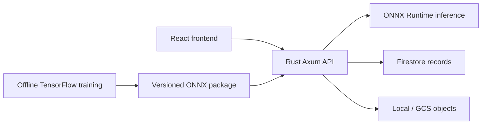

# Intelligent Manufacturing Quality Control

**React · Rust · TensorFlow · ONNX Runtime · Firestore · MLOps**

An independent ML engineering portfolio project by **Keeno Smith**. A working local visual-inspection platform that classifies six known steel surface-defect patterns, preserves human review and traces the model lifecycle from dataset preparation to rollback.

The product supports inspection consistency and traceability. It does **not** make industrial pass/fail decisions, classify normal products or detect every possible defect. No business improvement or production accuracy is claimed.

## Implemented Version 1

- React/Vite/TypeScript/Tailwind application: Overview, Inspections, Review Queue, Model Lab and MLOps & Monitoring, plus inspection detail.
- Actual configurable TensorFlow CNN training, image validation/deduplication, reproducible stratified splits, checkpointing, held-out metrics, error/calibration analysis and independent reevaluation.
- ONNX opset 17 export, executable graph checks and numerical parity; **Rust** executes online inference in a cached ONNX Runtime session.
- Firestore records, local/GCS object storage, filtered/paginated history and immutable prediction evidence with separate human corrections.
- Versioned model registry, compatible evaluation comparison, configurable quality gates, actual session activation, rejected releases and rollback.
- Stored-data monitoring, class/confidence/latency distributions, reviewed-sample agreement, PSI warnings and persistent snapshots.
- Application CI, manual ML validation and optional private Cloud Run deployment through OIDC/WIF.



## Quick start

Prerequisites: Python 3.12, Node 24, Rust with rustfmt/Clippy, Docker Desktop. Commands run from the repository root.

```sh
python3.12 -m venv .venv
.venv/bin/python -m pip install -r ml/requirements.txt
npm ci --prefix frontend
cp backend/.env.example backend/.env
# Edit backend/.env: set ADMIN_TOKEN, MODEL_ARTIFACT_PATH=artifacts,
# LOCAL_STORAGE_PATH=.storage and ALLOW_SYNTHETIC=true for local smoke mode.
export ADMIN_TOKEN='replace-with-a-long-local-operator-token'
docker compose up -d firestore
./scripts/bootstrap-smoke.sh smoke-a
./scripts/serve-api.sh
```

In another terminal: `npm run dev --prefix frontend`. Open http://localhost:5173. Enter the same token under Operator access; Model Lab → register `smoke-a` → validate & activate → Inspections → upload `data/synthetic/<class>/000.png` → review the prediction. API defaults to :5050; emulator to :8080. Full setup, command examples and port-conflict handling are in [setup](docs/setup.md).

A small actual trained ONNX CI fixture is included, allowing integration without retraining: start the API/emulator and run `ADMIN_TOKEN="$ADMIN_TOKEN" .venv/bin/python scripts/api-smoke.py`. This creates clearly synthetic test versions/inspections with real model outputs.

## Training, inference and verification

```sh
# Train another actual model on the same split, then independently validate export.
PYTHONPATH=ml/src .venv/bin/python -m qc train --version smoke-b --config ml/configs/smoke-b.json --epochs 35
.venv/bin/python scripts/validate-artifact.py artifacts/smoke-a --tensorflow
PYTHONPATH=ml/src .venv/bin/python -m qc evaluate --package artifacts/smoke-a
./scripts/check.sh
```

The intended real dataset is NEU-CLS; rights-verified acquisition and the exact input layout are documented in [machine learning](docs/machine-learning.md). No third-party images are bundled because redistribution terms were not established. Actual implementation training used 216 project-owned **procedural smoke images**. Smoke-a/b obtained macro-F1 1.0 on 36 held-out synthetic samples; this is software verification, **not industrial model quality**. Full TensorFlow/ONNX Runtime 1.23.2 parity passed with max error 4.77e-7. Rust shared pixel/probability parity passed.

Verified: 6 Python tests, 9 Rust tests, 6 frontend tests; lint/format/typechecks; Rust release and frontend production builds; real emulator-backed inspection/review/release/rollback/snapshot workflows; non-root container inference; responsive browser views and persisted browser review. Browser file-chooser upload was blocked by the automation tool; API and component upload passed. See [testing](docs/testing.md) for actual commands, failures, measurements and coverage gaps.

## Local containers and cloud readiness

`ADMIN_TOKEN=... docker compose up --build -d` runs frontend/API/emulator. Train outside the web containers and register mounted packages in Model Lab. Compose uses its own project namespace/named image/artifact volume. This Mac's default ports are occupied by other projects; verification used :5051/:5175 for direct mode and temporary overrides for containers. Default-port configuration remains :5050/:5173.

Cloud integration and a manual approved deployment workflow are implemented but **GCP was not accessed or deployed**. Cloud IAM browser access, WIF permissions, storage/service configuration and a rights-verified real model must be validated before production use. The V1 release coordinator supports one backend instance. See [deployment](docs/deployment.md).

## Engineering guide

| Area | Location |
|---|---|
| Frontend pages, UI and Fetch client | `frontend/src/` |
| Rust routes, inference, Firestore/storage and releases | `backend/src/` |
| Dataset, TensorFlow/export and offline evaluation | `ml/src/qc/` |
| Reproducible smoke, validation, integration and benchmark commands | `scripts/` |
| Actual small trained ONNX fixtures | `tests/fixtures/` |
| Software, ML and optional cloud workflows | `.github/workflows/` |

[Final report](docs/version1-report.md) · [Development log](docs/development-log.md) · [Architecture](docs/architecture.md) · [Setup](docs/setup.md) · [API](docs/api.md) · [Machine learning](docs/machine-learning.md) · [MLOps](docs/mlops.md) · [Data management](docs/data-management.md) · [Testing](docs/testing.md) · [Deployment](docs/deployment.md)

All work remains uncommitted. No staging, commits, pushes, merges or Git history changes were made.
