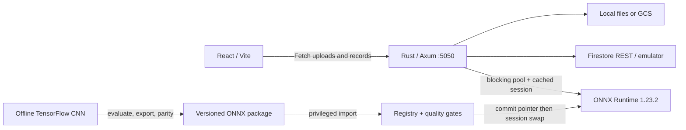
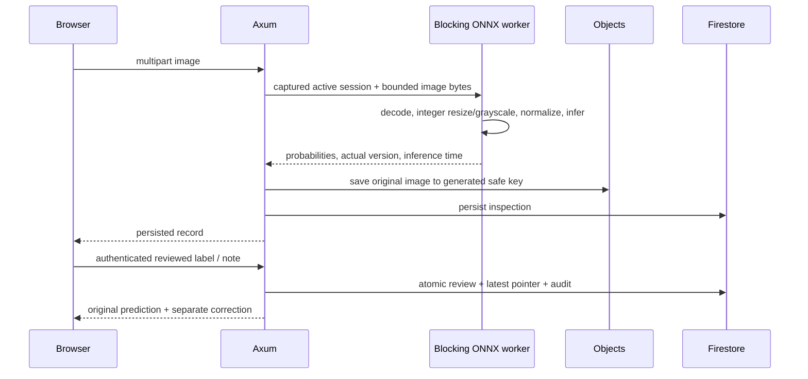

# Implemented architecture

## Main boundaries

`frontend/src/pages` contains the five primary product sections and inspection detail. Shared rendering, charts and data resource hooks live in components; services/api.ts is the sole Fetch adapter; types defines contracts. Router keeps navigation inside one browser session. The memory-only operator token is reset on browser refresh. Frontend rendering uses backend-derived records/evaluation and explicit loading/errors/empty states.

`backend/src/routes.rs` defines routes, request parsing, validation and HTTP responses. Business release coordination is in registry.rs; executable inference/preprocessing in inference.rs; pure aggregates in monitoring.rs; typed data in models.rs; centralized env config and structured errors are separate. firestore.rs owns REST serialization, page tokens, auth and bounded read retries. storage.rs owns safe keys, local atomic writes and GCS media/object operations. main.rs initializes ONNX, attempts persisted active-pointer restore, binds the API and handles graceful shutdown.

`ml/src/qc` is offline-only: data validation/splits/preprocessing, actual TensorFlow training and export, held-out metrics, independent ONNX reevaluation and CLI. No Python/Node online backend or external AI prediction API exists. Models are not loaded for each inspection.

## Pixel and inference flow

PNG/JPEG/BMP decode checks dimensions before allocating full image. Preprocessing is float32 NHWC grayscale, integer nearest coordinates, integer luminance, divide by 255; the same Python code prepares tensors before training. Lossless shared fixture pixel/probability parity is executable in both languages. JPEG decoder rounding can vary and needs representative deployment validation.

A session behind a Tokio mutex serializes inference safely. CPU work runs in spawn_blocking; async request/persistence work remains on Tokio. Captured session Arcs allow in-flight requests to finish safely through activation. Each record reports its actual model version. Image objects are stored before metadata; failed commits are reconciled by checking the record before deleting evidence, and ambiguous outcomes retain the image. Orphan reconciliation is an operator concern in V1.

## Model lifecycle

Packages include actual ONNX weights, metadata, class/preprocessing contract, evaluation, split manifest, configuration, export parity and checksums. Registration rejects incorrect paths/versions/checksums/contracts/output, loads and executes the graph and copies artifacts into the object store. Candidate model, evaluation, run and audit records are committed together.

A single release mutex coordinates local registration/validation/activation/reviews. Quality gates inspect measured macro-F1/per-class recall, compatible baseline/split and export evidence. Activation constructs a working session, atomically commits active/previous pointer and history/audit, then swaps the cached session. A restart restores the pointer; missing/corrupt models leave readiness false. Rollback loads the previous validated artifact first. An ambiguous release commit during a network outage may require restart/reconciliation; no exactly-once release API is claimed.

The [ort release notes](https://github.com/pykeio/ort/releases/tag/v2.0.0-rc.11) describe the macOS environment-lifetime fix used after reproducing a teardown crash in rc.10. Rust now pins rc.11 with Runtime 1.23.2. Python reports retain original exporter runtime versions and later independent parity verification.

## Persistence, monitoring and deployment

Firestore holds structured records and active pointers; object storage holds images/weights. Native nested JSON arrays (confusion matrices) are wrapped in reserved maps because Firestore does not allow direct nested arrays. REST commits use the [official atomic documents:commit endpoint](https://docs.cloud.google.com/firestore/docs/reference/rest/v1/projects.databases.documents/commit). Idempotent reads retry twice with 100/200 ms backoff on network/transient server/429 failures; mutations are not automatically retried. Requests have bounded timeouts.

Monitoring derives distributions, mean/p95 latency, reviewed-sample agreement/corrections from stored inspections. Process error counters are explicitly since startup. Active-model-only PSI compares class frequencies with its stored reference; no ground-truth drift/accuracy inference is claimed. Snapshots persist current aggregates.

Local direct development uses Firestore emulator and `.storage`; Compose uses a separate project namespace/named storage volume. Cloud adapters use metadata service credentials, Firestore REST and GCS object storage. Cloud Run image is non-root and private IAM access is required. **One backend instance** is required; horizontal coordination, production role management, real-data readiness and cloud deployment verification are outside the verified V1 capability. CORS and local operator bearer auth are development protections, not a production security certification.
